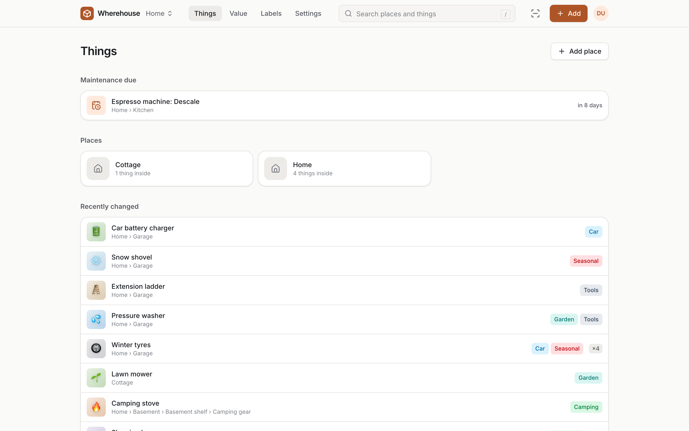
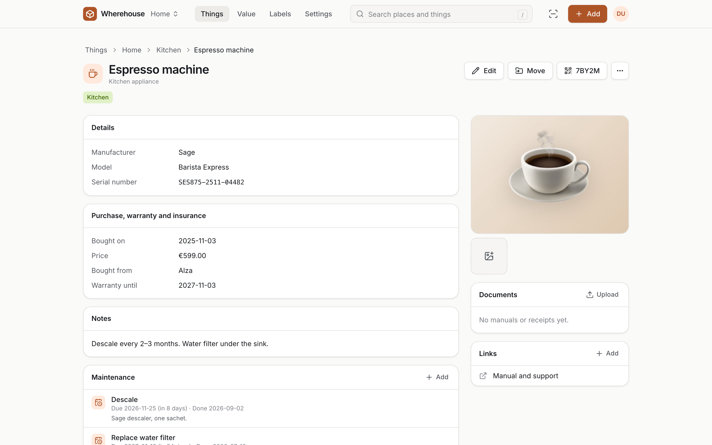
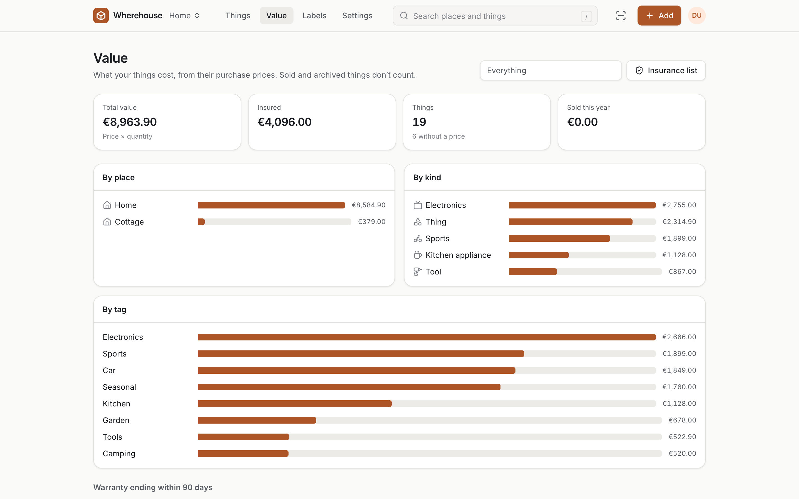
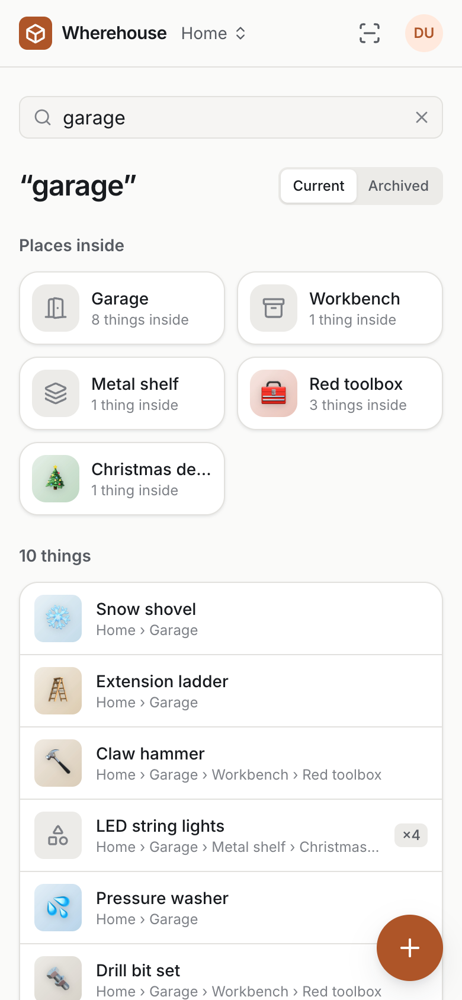

# Wherehouse

[](https://github.com/fhavrlent/wherehouse/actions/workflows/ci.yml)
[](https://github.com/fhavrlent/wherehouse/pkgs/container/wherehouse)
[](LICENSE)
[](go.mod)

Self-hosted home inventory: what you own, where it is, and what's in that box.

<picture>
  <source media="(prefers-color-scheme: dark)" srcset="docs/screenshots/things-dark.png">
  
</picture>

<table>
  <tr>
    <td width="40%"></td>
    <td width="40%"></td>
    <td width="20%"></td>
  </tr>
</table>

## Features

- Things hold things, to any depth: a building holds rooms, a room a shelf, a shelf a toolbox, the toolbox a drill. Each thing has its own details, so a box keeps its price and serial number. Moving a box moves everything in it.
- Adding a thing takes a photo and a name; on a phone, the camera opens straight away. "Add and next" keeps the place, for filling a box in one go.
- Search finds things by any word of their name, details, tags, custom fields, label code or the places they're in, as you type. Diacritics don't matter.
- QR labels for boxes, shelves and things, printed on common label sheets or a label printer. Scanning one (in the app, or with a phone's camera) opens its page. Blank labels can be printed ahead and attached when first scanned.
- Purchase date, price, seller, warranty, insurance and sale for every thing; the Value page totals what things cost, by place, kind and tag, and prints an insurance list.
- A maintenance log for every thing, with tasks that repeat (tyres every 6 months, a filter every year), a page of everything due, and reminders through ntfy, Gotify, Discord, Telegram, email and other services.
- Documents stored here or linked from Paperless-ngx, with links back from Paperless to the thing.
- Purchases and warranties kept in step with [Warranteed](https://github.com/fhavrlent/warranteed), its sibling app for warranty tracking.
- Kinds with about 140 icons (or your own), tags, custom fields, copies and templates.
- Several households, such as home and a cottage, each with its own people, invited with a link.
- Export as a spreadsheet, or everything with photos and documents as a ZIP, and restore that ZIP (up to 8 GB) as a new household.
- Sign-in through an OpenID Connect provider (Pocket ID, Authentik, Keycloak, …). There are no local passwords.
- Light and dark theme, usable on phones, in English and Czech.

The [user guide](docs/user-guide.md) shows how to use it, the [integration guide](docs/integrations.md) sets up Paperless-ngx, Warranteed and reminders step by step, and the [API reference](docs/api.md) is for your own scripts and apps.

## Installation

```sh
curl -O https://raw.githubusercontent.com/fhavrlent/wherehouse/main/docker-compose.yml
curl -o .env https://raw.githubusercontent.com/fhavrlent/wherehouse/main/.env.example
```

Edit `.env` (at least `WHEREHOUSE_APP_URL` and the `OIDC_*` values), then:

```sh
docker compose up -d
```

Run it behind a reverse proxy with HTTPS and set `WHEREHOUSE_APP_URL` to the public URL; label QR codes lead there.

## Sign-in

Create an OIDC client in your identity provider with the callback URL `https://<your host>/auth/callback`, then set:

```env
OIDC_ISSUER=https://id.example.com
OIDC_CLIENT_ID=...
OIDC_CLIENT_SECRET=...
OIDC_PROVIDER_NAME=Pocket ID
```

`OIDC_ISSUER` is the URL that serves `/.well-known/openid-configuration`. The client secret can be left empty for public clients.

- `OIDC_ALLOWED_GROUPS`: only members of these groups can sign in. Not needed if your provider already restricts the client to certain groups (Pocket ID does).
- `OIDC_ADMIN_GROUPS`: members of these groups are admins. If unset, the first user to sign in is the admin.

Group membership is re-checked every hour with a refresh token, so someone removed from the group is signed out within an hour, and their API tokens stop working. The check runs while they have a session here: API tokens of someone who never signs in again keep working until they are deleted, or the person is removed from the household.

The profile picture from the identity provider is downloaded only from public addresses or the provider's own host.

Everyone who signs in starts in a household of their own. Owners invite others with a link from **Settings → Household**; everyone in a household sees and changes all of its things. A person can be in several households and switches between them next to the logo.

## Labels

Open a thing and choose **Label** to give it one, or its menu → **Labels for everything inside**. Labels collect in the print list under **Labels**, which prints them on:

- A4, 21 labels 63.5 × 38.1 mm (Avery L7160)
- A4, 24 labels 70 × 37 mm
- A4, 65 labels 38.1 × 21.2 mm (Avery L7651)
- Letter, 30 labels 66.7 × 25.4 mm (Avery 5160)
- a label printer with 62 × 29 mm or 90 × 29 mm labels

Print at 100 % ("actual size"), with no margins. To use a partly used sheet, skip the labels already gone.

## Paperless-ngx

Set `PAPERLESS_URL` to your Paperless instance (and `PAPERLESS_PUBLIC_URL` if that's an internal address). Each person adds their own API token under **Settings → Paperless-ngx**, so Paperless's permissions decide what they can link. A linked document opens in Paperless, and the rest of the household can download it through the connection of whoever linked it. `PAPERLESS_TOKEN` is optional and only ever used for admins. See the [integration guide](docs/integrations.md#paperless-ngx) for links back from Paperless.

## Reminders

Under **Settings → Reminders**, add [Shoutrrr URLs](https://shoutrrr.nickfedor.com/latest/services/overview/) and how many days before maintenance is due to send a reminder (`7, 0` by default: a week before and on the day). Reminders go out once a day after `WHEREHOUSE_NOTIFY_HOUR`, each once.

Discord, Telegram, Slack, Pushover, Pushbullet, IFTTT and Join work for everyone. Services where the URL holds a server address (ntfy, Gotify, webhooks, email) are open to admins; others can use them only with hosts in `WHEREHOUSE_NOTIFY_ALLOWED_HOSTS`.

## Other apps

Apps such as Warranteed connect from their own settings: Wherehouse asks which households to connect, and the app gets a token for each that can do only what keeping things in step needs. For your own scripts, make a token under **Settings → API tokens**. [docs/api.md](docs/api.md) describes the API.

A connected app on the local network, such as Warranteed beside Wherehouse, is told about changes only if its host is in `WHEREHOUSE_HOOK_ALLOWED_HOSTS`; without it, the app still finds changes when it next looks, only later. The [integration guide](docs/integrations.md#warranteed) has a Docker Compose example.

## Configuration

| Variable | Default | Description |
| --- | --- | --- |
| `WHEREHOUSE_APP_URL` | `http://localhost:8080` | Public URL |
| `OIDC_ISSUER` | | Identity provider issuer URL (required) |
| `OIDC_CLIENT_ID` | | Client ID (required) |
| `OIDC_CLIENT_SECRET` | | Client secret |
| `OIDC_PROVIDER_NAME` | `SSO` | Login button label |
| `OIDC_SCOPES` | `openid profile email groups offline_access` | |
| `OIDC_ALLOWED_GROUPS` | | Comma-separated groups allowed to sign in |
| `OIDC_ADMIN_GROUPS` | | Comma-separated admin groups |
| `OIDC_GROUPS_CLAIM` | `groups` | Claim containing the user's groups |
| `OIDC_AUTO_REDIRECT` | `false` | Skip the login page |
| `OIDC_LOGOUT_AT_PROVIDER` | `false` | Also sign out at the provider |
| `OIDC_RECHECK_INTERVAL` | `1h` | How often group membership is re-checked |
| `PAPERLESS_URL` | | Paperless-ngx URL |
| `PAPERLESS_TOKEN` | | API token used for admins only |
| `PAPERLESS_PUBLIC_URL` | `PAPERLESS_URL` | Paperless URL used for browser links |
| `PAPERLESS_FIELD` | `Wherehouse` | Paperless URL custom field that links documents back here |
| `TZ` | | Timezone |
| `WHEREHOUSE_NOTIFY_HOUR` | `9` | Hour (0–23) after which reminders are sent |
| `WHEREHOUSE_NOTIFY_ALLOWED_HOSTS` | | Comma-separated hosts non-admins may use with self-hosted notification services |
| `WHEREHOUSE_HOOK_ALLOWED_HOSTS` | | Comma-separated hosts of connected apps on the local network (e.g. `warranteed`) that may be told about changes; others are told only on public addresses |
| `WHEREHOUSE_SECRET` | | Key for encrypting stored refresh tokens and Paperless tokens; generated in the data directory if unset |
| `WHEREHOUSE_MAX_UPLOAD_MB` | `50` | Maximum upload size |
| `WHEREHOUSE_SESSION_DAYS` | `30` | Session length |
| `WHEREHOUSE_DATA_DIR` | `/data` | Database directory (local disk) |
| `WHEREHOUSE_FILES_DIR` | `/data/files` | Photos and documents directory |
| `WHEREHOUSE_LISTEN` | `:8080` | Listen address |

## Storage and backups

The database (`wherehouse.db`, SQLite) is in `WHEREHOUSE_DATA_DIR`. Keep it on local disk; SQLite does not work reliably on NFS or SMB. Photos and documents are in `WHEREHOUSE_FILES_DIR`, which can be on network storage. Previews (`*.thumb.jpg`) can be left out of backups. To copy the database while the app runs, use `sqlite3 wherehouse.db ".backup backup.db"`.

The ZIP from **Settings → Export** holds one household with its files. **Restore from a backup…** next to it brings it back as a new household, on this or another Wherehouse, and leaves what is there alone. Labels already on things of another household on the same Wherehouse stay there, so the restored things come back without them.

The container runs as uid 65532; bind mounts must be writable by that user.

## Development

Requires Go 1.27+ and Node 24+.

```sh
make dev    # backend on :8095 with a development login (do not use in production)
make web    # frontend dev server on :5175
make test
```

## License

[MIT](LICENSE)
